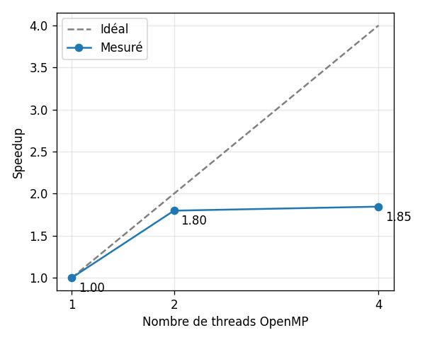

# coeur-2d : propagation électrique dans le tissu cardiaque

Simulation 2D d'ondes spirales dans le cœur, avec le modèle d'Aliev-Panfilov.
Code en C++17, parallélisé avec OpenMP, sorties HDF5 + XDMF lisibles dans ParaView.


## Le modèle

Deux variables par point du tissu : `u` (potentiel électrique) et `v` (récupération).

```
du/dt = D Δu − k u (u − a)(u − 1) − u v
dv/dt = ε(u,v) (−v − k u (u − a − 1))
ε(u,v) = ε0 + μ1 v / (u + μ2)
```

Paramètres : k = 8, a = 0.15, ε0 = 0.002, μ1 = 0.2, μ2 = 0.3, D = 1.

## Méthode numérique

- Différences finies, laplacien à 5 points, pas d'espace dx = 0.5
- Euler explicite, dt = 0.04 (condition de stabilité : dt ≤ dx² / 4D)
- Bords isolés (Neumann), gérés par cellules fantômes
- Condition initiale S1-S2 : un front plan rencontre une zone réfractaire, se casse et forme une spirale

## Parallélisation

La mise à jour de `u` lit les 4 voisins : elle écrit donc dans un tableau séparé `u_new`.
Chaque itération n'écrit que dans sa propre case, la boucle se parallélise sans conflit
avec un `#pragma omp parallel for`.

Résultats sur grille 512 × 512 (VM Ubuntu, 4 cœurs) :

| Threads | Temps (s) | Speedup |
|---------|-----------|---------|
| 1       | À COMPLÉTER | 1.00  |
| 2       | À COMPLÉTER |       |
| 4       | À COMPLÉTER |       |



Le résultat est identique au bit près entre 1 et N threads.

## Compiler et lancer

Dépendances (Ubuntu) : `sudo apt install cmake g++ libhdf5-dev python3-h5py python3-matplotlib`

```
cmake -S . -B build && cmake --build build
mkdir run && cd run
../build/coeur2d 256 1000 50        # taille, durée, nombre d'instantanés
python3 ../scripts/animation.py     # aperçu en GIF
```

Visualisation : ouvrir `run/sortie.xmf` dans ParaView.

Mesure du speedup :
```
../scripts/speedup.sh 512 500
python3 ../scripts/plot_speedup.py
```

## Suite prévue

- Parallélisation MPI par décomposition de domaine
- Écriture HDF5 parallèle
